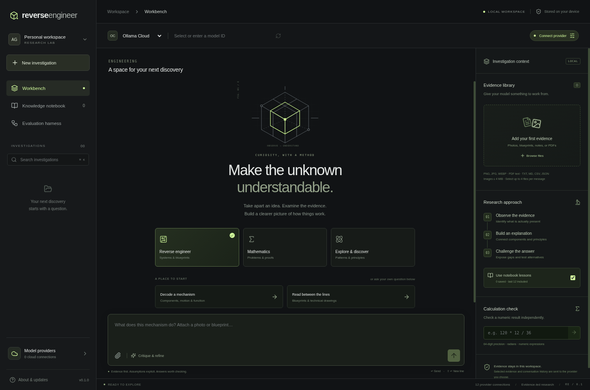

# Reverse Engineer

An Electron desktop research workspace for understanding mechanisms, working through mathematics, and investigating natural phenomena. React + TypeScript, with isolated native API access and local investigation history.



## Start

Use Node.js **24 LTS** and npm. On a desktop with a graphical session:

```sh
npm ci
npm run dev
```

The install step downloads the pinned Electron runtime using its official checksum-verified installer. The project currently uses Electron **45.2.1**, the npm latest release checked during implementation. In a managed cloud environment with an injected HTTP proxy, run installation with `NODE_USE_ENV_PROXY=1 npm ci` so Node's downloader uses the configured proxy and CA trust.

`npm run dev:web` opens a **UI preview only**. It does not accept API keys or make model requests. Run the Electron app for the complete workflow.

## Use it

1. Open **Model providers**, add your own API key, save it, then test the connection. Local Ollama needs a running Ollama instance and a pulled model instead of a key.
2. Choose a provider in the workbench. Refresh its model catalog and choose or type the exact model ID. Catalogs come from the provider, so newly available models do not require a hardcoded list update. Access and capabilities depend on your account and model; a catalog entry is not proof of vision, reasoning, or chat support.
3. Choose **Reverse engineer**, **Mathematics**, or **Explore & discover**. Add evidence and ask a question. An investigation's mode stays fixed; choosing another mode creates a new investigation.
4. Optionally enable **Critique & refine**. This makes **three billed model requests**: draft, critique, and revised answer. It uses the selected model for all three; critique is not independent validation. A failed or cancelled run saves no partial conversation turn.
5. Rate answers and choose **Save a lesson**. Write your own or use **Draft lesson with model** to reflect on the answer, critique, and feedback (one additional billed request). Review and edit the suggestion before saving. Use the **Evaluation harness** to compare baseline runs with and without notebook context. These are small keyword/number checks, not proof of reasoning capability or correctness.

### Providers

| Connection | API | Optional environment key |
| --- | --- | --- |
| Ollama Cloud | Native `/api/chat`, `/api/tags` at `https://ollama.com` | `OLLAMA_API_KEY` |
| OpenAI | Responses API; remote response storage disabled | `OPENAI_API_KEY` |
| Anthropic | Messages API | `ANTHROPIC_API_KEY` |
| Google Gemini | Generate Content API | `GEMINI_API_KEY` |
| Ollama Local | Native API on loopback, default port 11434 | None |
| OpenRouter | Chat Completions | `OPENROUTER_API_KEY` |
| xAI | Chat Completions | `XAI_API_KEY` |
| DeepSeek | Chat Completions | `DEEPSEEK_API_KEY` |
| Mistral | Chat Completions | `MISTRAL_API_KEY` |
| Groq | Chat Completions | `GROQ_API_KEY` |
| Together AI | Chat Completions | `TOGETHER_API_KEY` |
| Custom | Trusted compatible HTTPS endpoint (loopback HTTP supported) | `CUSTOM_API_KEY` |

These are provider integrations, not bundled models or subscriptions. Unusual model-specific parameters and non-chat model APIs are not automatically supported. The app uses non-streaming completions with progress stages, cancellation, and request timeouts. OpenAI, Anthropic, and Gemini have explicit output budgets; compatible APIs and Ollama use their model defaults.

### Evidence and mathematics

- PNG, JPEG, and WebP images: up to 4 MiB each. Use a vision-capable model. Images in the full conversation have an 8 MiB combined limit.
- Blueprint diagrams: export the relevant views as images. The app cannot infer exact hidden dimensions or materials from a picture alone, and it does not parse native CAD formats.
- PDFs: up to 10 MiB and 100,000 extracted characters. **Text extraction only**; diagrams and scanned pages must be exported as images. This limitation is shown on imported PDF cards.
- TXT, MD, CSV, JSON, and LOG: up to 512 KiB each. Up to 20 files per investigation and 4 selected per message. Conversation text plus extracted file context is capped at 200,000 characters before provider-specific context limits.
- The calculation panel evaluates bounded numeric expressions in a resource-limited worker using 64-digit decimal arithmetic. Supports arithmetic, powers, trigonometry in radians, roots, logarithms, and basic rounding. It does not execute arbitrary code or provide a symbolic theorem prover. Add a calculator result to your question with the plus button.
- Markdown, code blocks, tables, and LaTeX math render locally. Remote answer images are not loaded. Export an investigation to Markdown to retain answers, model provenance, evidence filenames, and critiques.

### What “learning” means here

The notebook is explicit, user-reviewed reference memory. The last 12 lessons, when enabled, are included in subsequent prompts and evaluation runs. Ratings are recorded but never silently promoted into lessons. There is no model-weight training, autonomous self-modification, browsing, arbitrary tool execution, or guarantee of solving open mathematical problems. This foundation makes proposed improvements inspectable rather than treating a model's own claims as established knowledge.

## Privacy and desktop boundaries

Electron runs with context isolation, sandboxed renderers, no renderer Node access, a restrictive CSP, denied browser permissions, blocked new windows/navigation, and validated main-frame IPC. Keys are stored through Electron `safeStorage` using the OS keychain when available. Linux's insecure `basic_text` fallback is refused: credentials remain in memory for that session. Keys never return through the preload API. Process environment keys are also supported; remove them from the environment to disconnect them.

Workspace files are stored under Electron's OS-specific `userData/workspace` directory (`workspace.json` and `settings.json`). **Investigations, evidence, and lessons are local filesystem data, not application-encrypted.** Protect and back up that directory accordingly. Exports contain conversation text and filenames, not raw evidence files or keys. Browser-preview state is separate, in localStorage.

Sending a message transmits its selected attachments, prior conversation/evidence history, the mode prompt, and optionally notebook lessons to the selected provider. Different providers can be selected between turns, so switching providers can share prior history with the newly selected service. External links ask before opening in the system browser. Custom endpoint changes require a new key; API calls reject redirects to avoid forwarding credentials to another host.

## Checks and packaging

```sh
npm test                 # Adapter contracts, credentials, files, calculator, memory
npm run build            # Strict typecheck, renderer and Electron bundles
npx playwright install chromium
npm run test:e2e         # Browser workflow tests; CHROMIUM_PATH can select an existing browser
npm run test:desktop     # Real Electron IPC and persistence, with a local fixture API
npm run dist:dir         # Unpacked desktop application for this OS
npm run dist             # Installer for this OS in release/
```

To run the same integration checks against an unpacked Linux build: `CI=1 REVERSE_ENGINEER_EXECUTABLE=release/linux-unpacked/reverse-engineer npm run test:desktop`. The checked-in app icon comes from `build/icon.svg`; regenerate its PNG with `node scripts/render-icon.mjs` after installing Playwright Chromium (`CHROMIUM_PATH` can select an existing browser).

The desktop smoke test is headless and isolated in a temporary userData directory. In CI containers that cannot provide the Chromium OS sandbox, `CI=1 npm run test:desktop` enables the test-only `--no-sandbox` flag. Production and development launch scripts retain Electron's normal sandbox. Linux requires Electron's standard GTK/NSS/GBM/audio libraries; Playwright's `install --with-deps chromium` installs the usual Linux CI prerequisites. The fixture API tests real request plumbing without credentials or external billing; **they do not establish live provider access or model quality**.

## Automatic updates and Electron releases

Installed builds check GitHub Releases at startup and every six hours, download an available application update, and install on exit. **About & updates** also supports manual checks and restart-to-install. Development builds do not auto-update.

An Electron app bundles its runtime. Upgrading Electron requires rebuilding, testing, signing, and distributing the application; swapping the runtime under a running app is unsupported. Dependabot checks npm daily and opens Electron/runtime update PRs. CI validates updates before maintainers release them. These PRs do **not** auto-merge or publish untested runtime upgrades.

The release workflow builds NSIS for Windows, DMG/ZIP for macOS, and AppImage for Linux, uploading artifacts and update metadata to a **draft GitHub Release** in `AaronGrace978/Reverse-Engineer`. To activate distribution:

1. Set repository signing secrets: `WIN_CSC_LINK`, `WIN_CSC_KEY_PASSWORD`, `MAC_CSC_LINK`, `MAC_CSC_KEY_PASSWORD`; and Apple notarization secrets `APPLE_ID`, `APPLE_APP_SPECIFIC_PASSWORD`, `APPLE_TEAM_ID`. Certificate links may be base64 signing certificates, as supported by electron-builder. Keep values in GitHub Secrets.
2. Bump `package.json` and the lockfile version, run checks, and push a matching `vX.Y.Z` tag. CI refuses unsigned Windows/macOS release jobs or mismatched versions.
3. Review the generated draft, test signed installers and a real upgrade from a previous version, then publish the release. Keep generated `latest*.yml`, blockmaps, and installer artifacts together. Linux auto-updates require running the AppImage distribution.

Release signing, notarization, publication, and an actual installed-build upgrade need release credentials and have not been verified in this cloud task.

## Source map

- `src/` — React workspace UI, Markdown/math rendering, shared types and provider catalog.
- `electron/main.ts`, `preload.ts` — restricted native bridge and workflow orchestration.
- `electron/gateway.ts` — provider authentication, request mapping, discovery, errors and cancellation.
- `electron/store.ts` — atomic local saves and keychain-backed credential handling.
- `electron/prompts.ts` — evidence discipline and per-workflow guidance.
- `electron/calculator*.ts`, `files.ts`, `updater.ts` — numeric verification, evidence ingestion, updates.
- `tests/`, `scripts/smoke-desktop.mjs` — unit/contracts, browser workflows, actual Electron integration.
